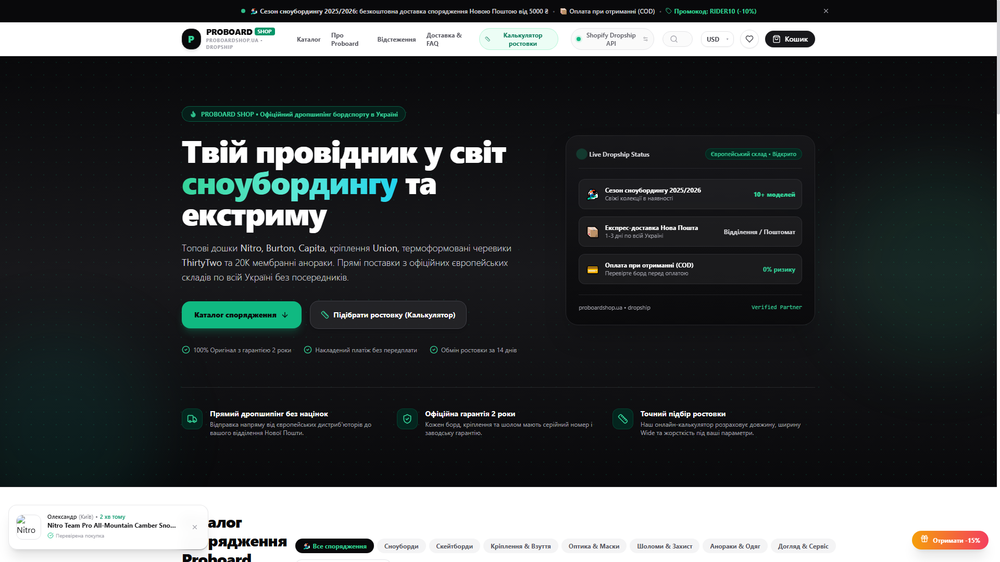
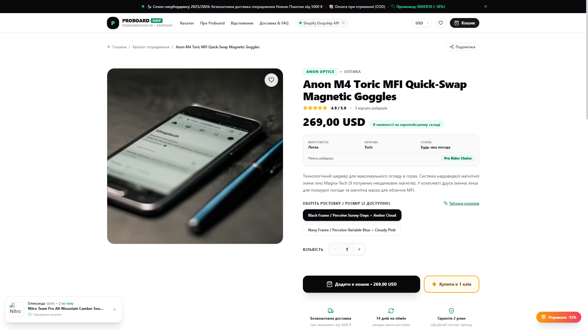

# 🏂 PROBOARD SHOP — Headless E-Commerce & Dropshipping Storefront


> **Високопродуктивний інтернет-магазин бордспорту та дропшипінгу нового покоління, створений на базі Next.js 14, TypeScript та Shopify Storefront GraphQL API за зразком провідного магазину Proboardshop.**

🔗 **Живе демо (Vercel Edge):** [https://shopify-store-nine-nu.vercel.app](https://shopify-store-nine-nu.vercel.app)  
☁️ **Живий сервер (Oracle Cloud Dedicated VPS + Nginx + PM2):** [https://findarticles-striking-partners-control.trycloudflare.com](https://findarticles-striking-partners-control.trycloudflare.com)  
📊 **Адмін-панель замовлень (CRM):** [https://shopify-store-nine-nu.vercel.app/admin](https://shopify-store-nine-nu.vercel.app/admin)  
📦 **Трекінг посилок для клієнтів:** [https://shopify-store-nine-nu.vercel.app/track-order](https://shopify-store-nine-nu.vercel.app/track-order)

---

## 📸 Галерея проєкту

| Головна сторінка & Hero | Картка товару (PDP) з характеристиками |
| :---: | :---: |
|  |  |

| Burton Custom Flying V & Огляди | Оптика Anon M4 Magna-Tech |
| :---: | :---: |
|  |  |

| Інтерактивний трекінг посилки | CRM Панель керування замовленнями |
| :---: | :---: |
|  |  |

---

## ⚡ Ключові можливості та архітектура

### 1. 🏂 Спеціалізований каталог екстремального спорядження
* **Провідні світові бренди:** *Nitro, Burton, Capita, Union, ThirtyTwo, Santa Cruz, Anon, Oakley, Montec*.
* **Категорії:** Сноуборди, Скейтборди, Кріплення & Черевики, Оптика & Маски, Шоломи & Захист, Анораки & Одяг, Сервіс & Парафін.
* **Технічні мікро-бейджи:** відображення індексу жорсткості (`Flex: 8/10`), форми (`Directional Twin`, `True Twin`), прогину (`Trüe Camber`, `Flying V`), мембрани (`20,000 mm`) та технологій захисту (`MIPS`).

### 2. 📏 Онлайн-калькулятор підбору ростовки (`BoardSizeCalculatorModal`)
* Інтерактивний алгоритм для сноубордистів:
  * Враховує вагу, зріст, стиль катання (*All-Mountain*, *Park/Freestyle*, *Freeride/Powder*), рівень катання та розмір ноги.
  * Розраховує діапазон довжини в сантиметрах (наприклад, `156 – 160 см`).
  * Виявляє потребу у версії **WIDE (W)** для взуття 44.5+ EU для запобігання чіплянню схилу носками.
  * Рекомендує оптимальний індекс Flex та форму прогину з можливістю застосувати фільтр до каталогу.

### 3. ⚡ 1-Click Checkout з месенджер-маршрутизацією
* Форма оформлення замовлення за 10 секунд без реєстрації.
* Вибір зручного каналу зв'язку: **Telegram**, **Viber** або телефонний дзвінок менеджера.
* Введення міста та відділення / поштомату **Нової Пошти**.
* Підтримка оплати при отриманні (**Накладений платіж COD**) та онлайн-еквайрингу.

### 4. 📊 Вбудована CRM-панель замовлень (`/admin`)
* Реальний REST API (`/api/orders`) для обробки замовлень.
* Зміна життєвого циклу статусу: `Новий` ➔ `В обробці` ➔ `Відправлено` ➔ `Виконано`.
* Метрики продажів: загальна виручка, середній чек, кількість замовлень.
* Кнопки швидкого дзвінка та відкриття чату в Telegram.
* Налаштування Telegram Webhook для миттєвих сповіщень про нові ліди.

### 5. 📦 Інтерактивний трекінг замовлень (`/track-order`)
* Клієнт може ввести номер замовлення (`ORD-...`) або номер телефону.
* 4-кроковий візуальний прогрес-бар від підтвердження до отримання у відділенні Нової Пошти.

### 6. 💱 Мультивалютний рушій
* Миттєвий перерахунок цін між **UAH (₴)**, **USD ($)**, **EUR (€)** та **GBP (£)** у реальному часі.

### 7. 🎁 Комплекти зі знижкою (Frequently Bought Together)
* Крос-сейл блоки на сторінці товару (наприклад, Сноуборд + Кріплення Union зі знижкою -15%).

---

## 🛠️ Стек технологій

| Сфера | Технології |
| :--- | :--- |
| **Фронтенд** | Next.js 14 (App Router, Server & Client Components), React 18, TypeScript |
| **Стилізація** | Tailwind CSS, Lucide React Icons |
| **Електронна комерція** | Shopify Storefront GraphQL API (v2024-01) + Live Fallback Engine |
| **Бекенд / API** | Next.js Route Handlers (`/api/orders`), Webhook Dispatcher |
| **SEO & Продуктивність** | Dynamic Metadata, OpenGraph, `sitemap.xml`, `robots.txt` |
| **Деплой & Хостинг** | Vercel Serverless Edge Platform |

---

## 🚀 Швидкий запуск проєкту локально

### 1. Клонування репозиторію
```bash
git clone https://github.com/DudarDev/proboard-shop.git
cd proboard-shop
```

### 2. Встановлення залежностей
```bash
npm install
```

### 3. Запуск у режимі розробки
```bash
npm run dev
```
Відкрийте [http://localhost:3000](http://localhost:3000) у вашому браузері.

### 4. Збірка для продакшену
```bash
npm run build
npm run start
```

---

## 🔑 Підключення до реального магазину Shopify

Проєкт підтримує два режими:
1. **Автономний демо-режим:** повний каталог бордспорту з локальним збереженням замовлень та синхронізацією.
2. **Shopify Live Storefront:**
   * Вкажіть змінні у файлі `.env.local`:
     ```env
     NEXT_PUBLIC_SHOPIFY_STORE_DOMAIN="your-shop-name.myshopify.com"
     NEXT_PUBLIC_SHOPIFY_STOREFRONT_ACCESS_TOKEN="your_storefront_access_token"
     ```
   * Або скористайтеся модальним вікном налаштувань прямо в інтерфейсі (іконка шестерні в шапці сайту).

---

## 👨‍💻 Розробник & Портфоліо

Розроблено як high-ticket демонстраційний проєкт для портфоліо e-commerce розробки.

* **GitHub:** [@DudarDev](https://github.com/DudarDev)
* **Live Store:** [https://shopify-store-nine-nu.vercel.app](https://shopify-store-nine-nu.vercel.app)
* **Категорія:** Headless Shopify / Full-Stack Next.js E-Commerce / Dropshipping Platform

---

## 📄 Ліцензія
MIT License © 2026 PROBOARD SHOP / DudarDev
