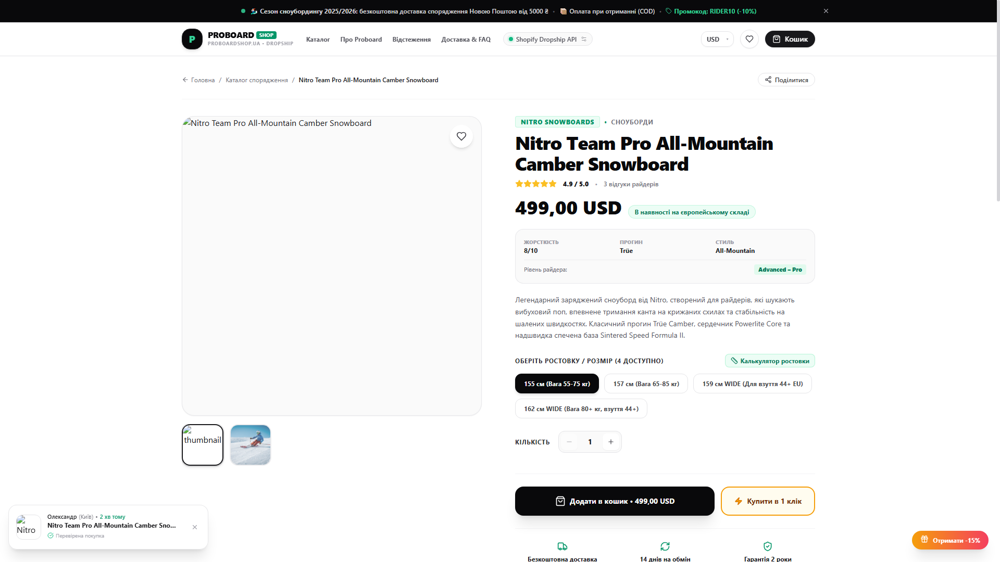
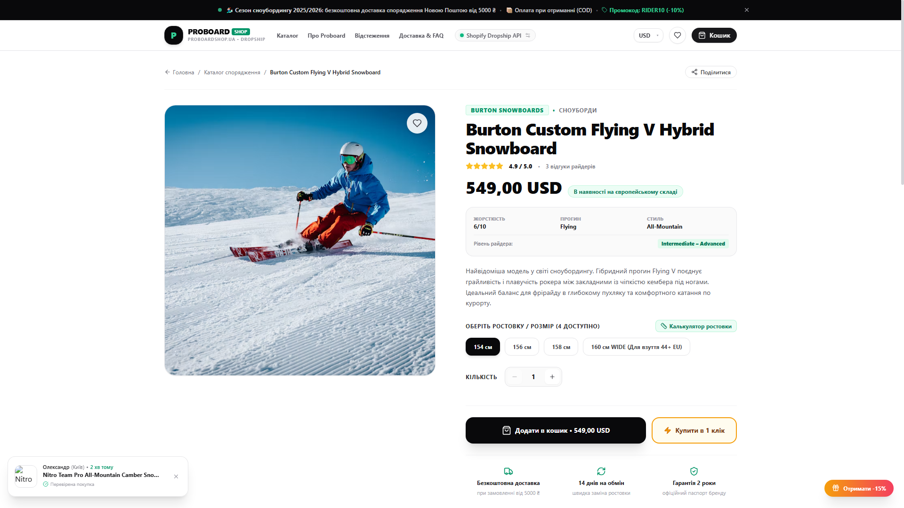
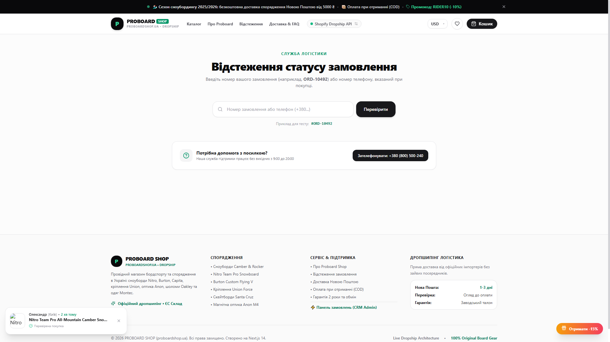
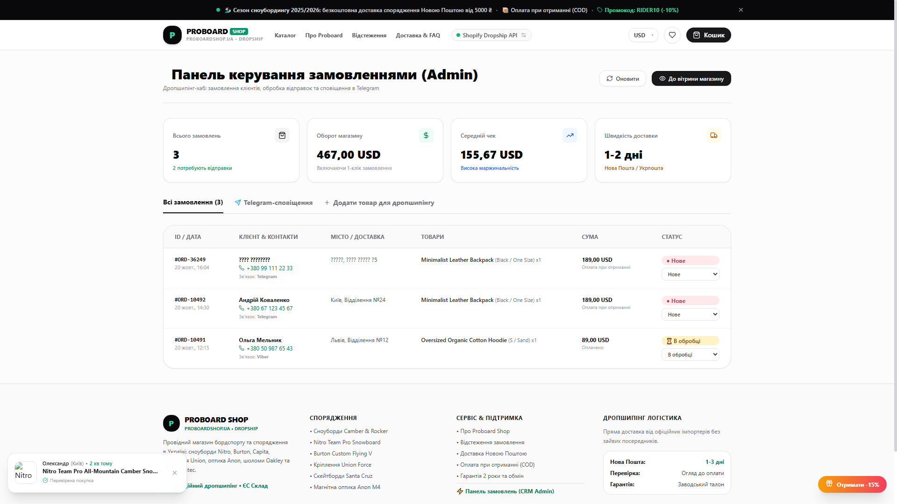

# 🏂 PROBOARD SHOP — Production-Ready Headless E-Commerce Starter Kit


> **Сучасна, високопродуктивна headless-вітрина інтернет-магазину бордспорту та дропшипінгу нового покоління, створена на базі Next.js 14 App Router, TypeScript та Shopify Storefront GraphQL API (версія 2026-10).**  
> Поєднує 100% автономний Demo-режим із повноцінною підтримкою живого магазину Shopify, Cart API, вбудованою захищеною CRM, онлайн-калькулятором ростовки та повною двомовною локалізацією (UA / EN).

---

## ⚡ Швидкі посилання

* 🌐 **GitHub Репозиторій:** [https://github.com/DudarDev/proboard-shop](https://github.com/DudarDev/proboard-shop)
* 🚀 **Демо-вітрина:** [https://shopify-store-nine-nu.vercel.app](https://shopify-store-nine-nu.vercel.app)
* 📊 **Панель керування замовленнями (CRM):** [/admin](https://shopify-store-nine-nu.vercel.app/admin)
* 📦 **Трекінг відправок:** [/track-order](https://shopify-store-nine-nu.vercel.app/track-order)

---

## 📸 Галерея та візуальний огляд

| Головна вітрина & Hero | Картка товару (PDP) з характеристиками |
| :---: | :---: |
|  |  |

| Огляди спорядження & Ростовки | Оптика та аксесуари |
| :---: | :---: |
|  |  |

| Трекінг замовлення для покупця | Захищена CRM-панель замовлень |
| :---: | :---: |
|  |  |

---

## 🏗️ Архітектура системи

```
proboard-shop/
├── src/
│   ├── app/                      # Next.js 14 App Router
│   │   ├── admin/                # Захищена панель CRM (AdminAuthGate + Orders)
│   │   ├── api/orders/           # REST API: Rate limiting, order storage, Telegram bot
│   │   ├── products/[handle]/    # Модульна сторінка товару (PDP)
│   │   └── track-order/          # Сторінка трекінгу замовлення клієнта
│   ├── components/               # UI Компоненти
│   │   ├── admin/                # AdminAuthGate, AdminStatsCards, AdminOrdersTable
│   │   ├── product/              # ProductGallery, ProductSpecsTable, ProductPurchaseBox
│   │   ├── CartDrawer.tsx        # Shopify Cart API + Demo Drawer
│   │   ├── OneClickModal.tsx     # Експрес-замовлення в 1 клік
│   │   └── BoardSizeCalculatorModal.tsx # Алгоритм підбору ростовки
│   ├── context/                  # React Context: Cart, Wishlist, Config (валюта/мова)
│   ├── data/                     # mockProducts.ts, orders.json
│   ├── lib/                      # Ядро інтеграцій та утиліти
│   │   ├── shopify.ts            # GraphQL Storefront API v2026-10 + Cart mutation
│   │   ├── orderStorage.ts       # Трьохрівневе сховище замовлень (JSON / /tmp / Memory)
│   │   ├── rateLimit.ts          # In-memory IP-based Rate Limiter (sliding window)
│   │   └── translations.ts       # Повна 100% двомовна локалізація (UA / EN)
│   └── types/                    # TypeScript типи (Shopify, Metafields, Orders)
```

---

## 💎 Ключові можливості

### 1. 🏂 Shopify Storefront API v2026-10 & Metafields
* **Підтримка Metafields для дощок:** автоматична вибірка та безпечний мапінг параметрів:
  * `custom.flex_rating` — шкала жорсткості (1–10)
  * `custom.camber_type` — тип прогину (Camber, Rocker, Flying V, Flat)
  * `custom.riding_style` — стиль (All-Mountain, Freestyle, Freeride, Powder)
  * `custom.terrain` — локація та тип снігу
* **Стійкий маппер (`mapShopifyProduct`):** безпечно приводить товари до єдиного інтерфейсу; якщо метаполя в магазині клієнта відсутні — вітрина та фільтри працюють без збоїв.
* **Shopify Cart API (`cartCreate`):** створення реального кошика в Shopify та миттєвий редірект на офіційний `checkoutUrl`.
* **Захист кошика:** перевірка формату GID (`gid://shopify/ProductVariant/...`) — при переході з Demo-режиму на реальний Shopify виводиться дружнє попередження з пропозицією очистити кошик.

### 2. 🔐 Безпека та захист API
* **Ізоляція `/admin`:** жодні дані клієнтів чи замовлень не віддаються та не рендеряться без успішної перевірки секретного ключа `x-admin-key`.
* **Криптографічний ключ:** генерація 32+ символьного `ADMIN_API_KEY` (зберігається в `.env.local`, плейсхолдер у `.env.local.example`).
* **Rate Limiting (`rateLimit.ts`):** захист від спаму та перевантаження (10 запитів/хв на оформлення замовлень, 25 запитів/хв на адмін-роути) з урахуванням проксі (`x-forwarded-for`, `cf-connecting-ip`).
* **Захист від XSS та санітизація:** сувора типізація та валідація номерів телефонів і текстових полів.

### 3. 💾 Трьохрівневе сховище замовлень (`orderStorage.ts`)
* **Level 1 (Локальний файл):** `src/data/orders.json` з атомарним записом для надійності.
* **Level 2 (Serverless /tmp):** автоматичне перемикання на `/tmp/proboard-orders.json` у середовищах із read-only файловою системою (Vercel, AWS Lambda) — запобігає 500 помилкам.
* **Level 3 (In-Memory Fallback):** черга в оперативній пам'яті як захисний механізм.

### 4. 🧩 Модульна компонентна база
* Сторінка товару (PDP) декомпозована на незалежні компоненти:
  * `ProductGallery`: головний ракурс, мультиракурсні мініатюри, кнопка обраного
  * `ProductSpecsTable`: візуальна 10-бальна шкала жорсткості, геометрія, канти, гарантія
  * `ProductPurchaseBox`: ціни зі знижкою, селектор розмірів, калькулятор, кнопка в 1 клік
* Панель управління (CRM) розділена на:
  * `AdminAuthGate`: безпечний екран авторизації
  * `AdminStatsCards`: метрики виручки, кількості замовлень, середнього чека
  * `AdminOrdersTable`: фільтрація за статусами, керування життєвим циклом

### 5. 🌐 Повна локалізація (UA / EN)
* 100% текстів інтерфейсу підтримують миттєве перемикання між українською та англійською мовами через єдиний словник `src/lib/translations.ts`.

---

## 🛠️ Стек технологій

| Сфера | Технології |
| :--- | :--- |
| **Фронтенд** | Next.js 14 (App Router, Server & Client Components), React 18, TypeScript 5 |
| **Стилізація** | Tailwind CSS 3.4, Lucide React Icons |
| **Електронна комерція** | Shopify Storefront API (v2026-10), Cart API (`cartCreate`), GraphQL |
| **Бекенд / API** | Next.js Route Handlers (`/api/orders`), Rate Limiter, Order Storage Service |
| **Безпека** | Header-based Auth (`x-admin-key`), In-Memory Rate Limiting, Input Validation |
| **Деплой** | Vercel Edge / Dedicated VPS (Ubuntu 22.04 LTS + PM2 + Nginx) |

---

## 🚀 Швидкий запуск проєкту локально

### 1. Клонування репозиторію
```bash
git clone https://github.com/DudarDev/proboard-shop.git
cd proboard-shop
```

### 2. Встановлення залежностей
```bash
npm install
```

### 3. Конфігурація змінних оточення
Створіть `.env.local` на основі наданого зразка:
```bash
cp .env.local.example .env.local
```

| Змінна | Обов'язкова | Опис |
| :--- | :---: | :--- |
| `ADMIN_API_KEY` | **Так (для CRM)** | Секретний ключ для захисту `GET/PATCH /api/orders` та входу в `/admin` (мінімум 32 символи). |
| `NEXT_PUBLIC_SHOPIFY_API_VERSION` | Ні | Версія Storefront API (за замовчуванням `2026-10`). |
| `NEXT_PUBLIC_SHOPIFY_STORE_DOMAIN` | Ні | Домен вашого Shopify (`my-shop.myshopify.com`). Якщо порожньо — працює Demo Mode. |
| `NEXT_PUBLIC_SHOPIFY_STOREFRONT_ACCESS_TOKEN` | Ні | Storefront Access Token із налаштувань додатку Shopify. |
| `TELEGRAM_BOT_TOKEN` | Ні | Токен Telegram-бота для сповіщень про замовлення. |
| `TELEGRAM_CHAT_ID` | Ні | Chat ID для отримання сповіщень. |

### 4. Запуск у режимі розробки
```bash
npm run dev
```
Відкрийте [http://localhost:3000](http://localhost:3000) у браузері.

### 5. Збірка для продакшену
```bash
npm run build
npm run start
```

---

## 🗺️ Дорожня карта розвитку (Production Roadmap)

1. **Міграція на повноцінну СУБД:**
   * Підключення PostgreSQL / Supabase через Prisma ORM або Drizzle ORM для необмеженого масштабування замовлень та аналітики.
2. **Shopify Admin Webhooks:**
   * Підписка на події `orders/create`, `inventory_levels/update` для автоматичної двосторонньої синхронізації залишків на складі в режимі реального часу.
3. **Платіжні шлюзи та логістика:**
   * Інтеграція офіційного API Нової Пошти (автоматичне створення ЕН / ТТН, трекінг статусів).
   * Підключення платіжних еквайрингів WayForPay, LiqPay, Monobank та Stripe.
4. **Персоналізація покупця:**
   * Кабінет покупця (Shopify Customer Account API), збереження улюблених товарів у хмарі, історія замовлень.

---

## 📄 Ліцензія

Розповсюджується під ліцензією **MIT License**. Дозволяється вільне комерційне використання, модифікація та адаптація.  
© 2026 PROBOARD SHOP / [DudarDev](https://github.com/DudarDev)
